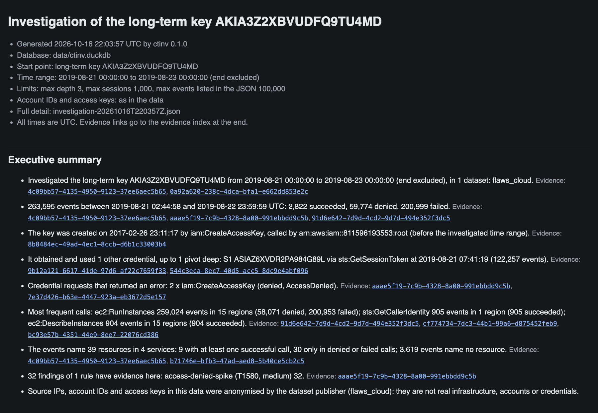

# CloudTrail Investigator (`ctinv`)

An offline forensic investigation tool for AWS CloudTrail logs (learning
project).

> **Notice.** This is a learning project for my cybersecurity degree. Only
> public datasets were used: no AWS account of my own, no data from employers
> or customers. It has not been run on production logs and is not a product.

`ctinv` answers three questions about an AWS identity from its CloudTrail
logs: *What did it do? What did it touch? Did it try to stay or to hide?* Every
statement in its reports cites the CloudTrail eventIDs it rests on, and its
detection rules come with a measured, per-technique evaluation, denominators
included.



*Executive summary of the HTML report from the [case study](docs/CASE_STUDY.md):
the public access key of a flaws.cloud challenge user over 48 hours. Every line
links to its evidence. The key, account ID and addresses in this public dataset
were anonymised by its publisher.*

## What it does

| Command | What it does | Details |
|---|---|---|
| `ctinv ingest` | Streams CloudTrail `.json` / `.json.gz` files (delivery format, NDJSON or single events) into a local DuckDB database. Deduplicates on eventID, quarantines malformed records with the reason, records the SHA-256 of every file. | [SCHEMA.md](docs/SCHEMA.md) |
| `ctinv detect` | Runs detection rules (YAML metadata + SQL) and stores findings. A finding without evidence eventIDs cannot exist: the framework and a database constraint reject it. | [DETECTION.md](docs/DETECTION.md) |
| `ctinv investigate` | Starts from an access key or principal and follows the credentials it obtained (`AssumeRole`, `GetSessionToken`, ...) to the sessions that used them: session graph, timeline, blast radius (resources touched, split into succeeded, denied and failed) and the findings in it. Depth, session and event limits. | [INVESTIGATION.md](docs/INVESTIGATION.md) |
| `ctinv report` | Turns an investigation or the findings into Markdown, a self-contained HTML page (no scripts, strict CSP) and JSON. Findings grouped by ATT&CK tactic, condensed timeline, IOCs, limitations, an evidence index locating every cited record in its source file. Optional `--redact`. | [REPORTING.md](docs/REPORTING.md) |
| `ctinv evaluate` | Measures detection per attack technique against labelled data: a held-out test set and a development set, reported separately. | [EVALUATION.md](docs/EVALUATION.md) |

**Example.** The [case study](docs/CASE_STUDY.md) follows the public key of the
flaws.cloud challenge user `Level6` through 263,595 calls in 48 hours. 263,413
of them come from one script that obtained a 36-hour session key, tried to
create an IAM user and access keys (denied), and then made 259,024
`RunInstances` calls in 15 regions with 149 instance types. None succeeded.
The report shows this with evidence in 14 seconds; the case study also shows
what the rules missed.

## Detection rules

Nine rules, ATT&CK Enterprise v20.0. ATT&CK v19 (April 2026) replaced some IDs
that public content still uses; the former ID is shown where it changed.

| Rule | Finds | Severity | ATT&CK v20.0 technique | Tactics | Findings on flaws.cloud |
|---|---|---|---|---|---:|
| `access-denied-spike` | Many access-denied errors from one identity | medium | T1580 Cloud Infrastructure Discovery | Discovery | 540 |
| `admin-policy-attached` | Administrator access granted to a user, role or group | high | T1098.003 Account Manipulation: Additional Cloud Roles | Persistence, Privilege Escalation | 1 |
| `cloudtrail-tampering` | CloudTrail logging stopped, deleted or reduced | high | T1685.002 (formerly T1562.008) Disable or Modify Tools: Disable or Modify Cloud Log | Defense Impairment | 3 |
| `console-login-without-mfa` | Console sign-in without MFA | medium | T1078.004 Valid Accounts: Cloud Accounts | Initial Access | 1 |
| `credentials-created-for-other-user` | Access key or console password created for another user | medium | T1098.001 Account Manipulation: Additional Cloud Credentials | Persistence, Privilege Escalation | 10 |
| `discovery-burst` | Burst of List, Describe and Get calls from one identity | low | T1580 Cloud Infrastructure Discovery | Discovery | 332 |
| `new-region-activity` | Identity active in a region it never used before | medium | T1535 Unused/Unsupported Cloud Regions | Stealth | 15 |
| `root-account-usage` | Root user activity | medium | T1078.004 Valid Accounts: Cloud Accounts | Initial Access, Privilege Escalation | 69 |
| `snapshot-or-image-shared` | Snapshot or machine image shared with another account | high | T1537 Transfer Data to Cloud Account | Exfiltration | 37 |

Counts are on the 1,225,784 unique flaws.cloud events (2017–2020) with default
parameters. Each rule file documents its logic, known false positives and
gaps; thresholds can be changed per run (`--set RULE.PARAM=VALUE`).

## Evaluation

The unit of analysis is the **attack technique**, not events or findings:
several recordings of one technique are not independent samples. Rates always
come with their denominator, and the two datasets are never added up. Full
method and tables: [EVALUATION.md](docs/EVALUATION.md).

### How the ground truth was made

- **Development set: Invictus IR Sigma-AWS** (2,900 events from running Stratus
  Red Team's AWS techniques in a lab). The data names no techniques. Every
  event's technique and role (attack, warm-up, clean-up, background, ...) was
  derived from Stratus Red Team's source code and frozen, with SHA-256 hashes
  and a test, before any detection rule existed. The rules were then written
  on this data, so its results are **optimistic**.
- **Held-out test set: Splunk attack_data** (49 CloudTrail files, one ATT&CK
  label per scenario file, Splunk's own). Its event content was not opened
  while the rules were written. The rule set was then frozen with the git tag
  `rules-frozen-for-eval`; the evaluation method and a review of every file's
  label were committed before the first run.

### Test set (held out, primary result)

**5 / 23** in-scope ATT&CK techniques are detected by a rule mapped to that
technique. 9 / 23 have at least one finding of any rule in their scenario, and
9 / 27 when the four excluded techniques are counted as missed.

| ATT&CK v20.0 | Name | Rule mapped to the technique fired | Any finding | Rules that fired | Files detected |
|---|---|---|---|---|---|
| T1021.004 | SSH | no | missed | – | 0 / 1 |
| T1021.008 | Direct Cloud VM Connections | no | missed | – | 0 / 1 |
| T1078 | Valid Accounts | yes | detected | `console-login-without-mfa`, `credentials-created-for-other-user` | 2 / 6 |
| T1078.004 | Cloud Accounts | yes | detected | `console-login-without-mfa`, `root-account-usage` | 1 / 1 |
| T1087.004 | Cloud Account | – | label ambiguous | – | – |
| T1098 | Account Manipulation | no | missed | – | 0 / 3 |
| T1098.003 | Additional Cloud Roles | no | missed | – | 0 / 1 |
| T1110.001 | Password Guessing | no | missed | – | 0 / 1 |
| T1110.002 | Password Cracking | – | label ambiguous | – | – |
| T1110.003 | Password Spraying | no | missed | – | 0 / 2 |
| T1119 | Automated Collection | no | missed | – | 0 / 1 |
| T1201 | Password Policy Discovery | no | detected | `root-account-usage` | 1 / 1 |
| T1204 | User Execution | – | label ambiguous | – | – |
| T1204.003 | Malicious Image | no | missed | – | 0 / 1 |
| T1485 | Data Destruction | no | missed | – | 0 / 1 |
| T1486 | Data Encrypted for Impact | no | missed | – | 0 / 1 |
| T1526 | Cloud Service Discovery | no | detected | `access-denied-spike`, `discovery-burst` | 1 / 1 |
| T1530 | Data from Cloud Storage | no | missed | – | 0 / 1 |
| T1537 | Transfer Data to Cloud Account | yes | detected | `snapshot-or-image-shared` | 2 / 2 |
| T1552 | Unsecured Credentials | no | detected | `access-denied-spike` | 1 / 1 |
| T1555.006 | Cloud Secrets Management Stores | no | missed | – | 0 / 1 |
| T1578.005 | Modify Cloud Compute Configurations | no | missed | – | 0 / 1 |
| T1580 | Cloud Infrastructure Discovery | yes | detected | `access-denied-spike`, `discovery-burst` | 2 / 3 |
| T1586.003 | Cloud Accounts | – | label ambiguous | – | – |
| T1621 | Multi-Factor Authentication Request Generation | no | detected | `root-account-usage` | 1 / 1 |
| T1685.002 (formerly T1562.008) | Disable or Modify Cloud Log | yes | detected | `cloudtrail-tampering` | 3 / 6 |
| T1686.001 (formerly T1562.007) | Cloud Firewall | no | missed | – | 0 / 1 |

How to read it:

- The headline counts only the technique-matched detections. Four techniques
  have a finding only for unrelated reasons: T1201 and T1621 because their
  scenarios ran as root, T1526 and T1552 through the burst and permission-error
  rules, which are mapped to T1580.
- **Excluded (label ambiguous), 4 techniques:** the scenario's events do not
  show the labelled technique (judged against the ATT&CK v20.0 descriptions
  before the first run). T1087.004 is one denied model invocation, T1110.002 a
  password reset through the API, T1204 a Lambda code update through the API,
  T1586.003 sign-ins to the target's own root user. **Out of scope by design:**
  no technique; two files containing only S3 data events are out of scope, but
  their techniques stay in scope through other files.
- 13 of the 14 missed techniques have no rule for the scenario's behaviour.
  T1098.003 has one, but it looks for administrator policies, not for roles
  trusted by other accounts.
- T1201 and T1204.003 were seen before the test set was split off; without
  them, 8 / 21 have any finding.
- Splunk's file names reveal which techniques the test set covers, so the
  choice of rules was not blind to that list.

### Development set (optimistic)

**15 / 26** Stratus Red Team techniques detected (one technique out of scope by
design: it was never detonated, its warm-up failed). 12 / 26 without three
techniques found only through one `discovery-burst` finding whose 1,337
evidence events are mostly lab set-up and clean-up calls (60 are attack calls).
Failed attempts detected: 2 / 3. Of 22 findings, 17 rest on attack events and
5 only on lab scaffolding. Not comparable with the test set: other data,
another unit (Stratus techniques).

### Manually reviewed sample (flaws.cloud), not a false-positive rate

There is no benign baseline dataset, so **no false-positive rate is
measured.** 65 flaws.cloud findings (up to 10 per rule) were drawn at random
and reviewed by hand; labels were proposed by the tool author's assistant from
the CloudTrail events and each decided by a human. Result: 37 true positives,
28 benign true positives (expected activity, e.g. the account owner's MFA root
sessions), 0 false positives, 0 unsure; 2 of 65 proposals changed. flaws.cloud
was used to write the rules, so this says little about unseen data.

**After the freeze**, one bug was fixed: failed console sign-ins counted as
successful (see "What I learned"). The re-run is reported separately; every
rate stayed the same and the outcome of three test-set findings changed.

## Limitations

- **Lab and curated data, not production.** The development set is one short
  lab session; most test scenarios hold only the few events of the attack
  (27 of 49 files have fewer than 10 events). Real accounts are noisier, and
  the test set says nothing about false positives.
- **Anonymised IPs in flaws.cloud.** The publisher replaced IP addresses,
  account IDs and access keys with random values. Addresses can be compared
  within the dataset but carry no location or owner, so no geolocation logic
  could be validated.
- **Management events only.** The rules and investigations cover CloudTrail
  management events; data events (S3 object access, Lambda invocations) are
  ingested but no rule looks at them, and the datasets mostly lack them.
- **CloudTrail delivery delay.** AWS states that CloudTrail typically delivers
  an event within 5 minutes of the API call and writes log files to S3 about
  every five minutes (CloudTrail FAQ). `ctinv` works on files after the fact,
  so in practice it is at least that far behind; batch detection cannot say
  exactly when a threshold was crossed.
- **Small, partly non-blind test set:** mostly one scenario file per
  technique, and the rule set was chosen with the test set's technique list
  visible.
- **One-second timestamps.** Events in the same second are ordered by eventID;
  their real order is unknown.
- Developed on Python 3.14 (macOS); the CI workflow tests 3.11 to 3.14.

## Related work

| Project | What it is | How `ctinv` differs |
|---|---|---|
| [SigmaHQ](https://github.com/SigmaHQ/sigma) AWS CloudTrail rules | A large community rule collection in a SIEM-neutral format, converted into queries for a SIEM | Far fewer rules, but they run as is on a local database; each finding carries its evidence eventIDs, and the rules are evaluated per technique |
| [Stratus Red Team](https://stratus-red-team.cloud/) | Adversary emulation: runs cloud attack techniques in a real account | Used here indirectly: the development set was recorded with it, and its source code is the ground truth for the labels |
| [Invictus IR](https://github.com/invictus-ir) | Incident-response company publishing open-source cloud IR tooling and datasets | Its Sigma-AWS dataset is the development set here |
| [Prowler](https://github.com/prowler-cloud/prowler) | Cloud security posture assessment: checks configuration against best practices and compliance frameworks | Looks at what happened in the logs, not at how the account is configured |
| [AWS CloudTrail Lake](https://docs.aws.amazon.com/awscloudtrail/latest/userguide/cloudtrail-lake.html) | Managed, SQL-queryable event store inside AWS | Offline on exported files, no AWS access needed; adds credential pivoting, evidence-linked reports and an evaluation |

## Installation

Python 3.11 or newer. Not published on PyPI.

```bash
git clone https://github.com/kevinmekic/cloudtrail-investigator.git
cd cloudtrail-investigator
python3 -m venv .venv
source .venv/bin/activate
pip install -e .            # or: pip install -e ".[dev]" for tests and linting
```

Runtime dependencies: `duckdb`, `jinja2`, `pyyaml`, `rich`.

## Datasets

```bash
python scripts/fetch_datasets.py                                # flaws.cloud + Invictus
python scripts/fetch_datasets.py --dataset splunk_attack_data   # optional: the test set
```

Every file is pinned by URL, size and SHA-256 (`scripts/datasets.lock.json`);
a file that does not match is rejected. Data goes to `data/`, which is never
committed.

| Dataset | Records | Use | Terms |
|---|---:|---|---|
| flaws.cloud CloudTrail logs (Summit Route) | 1,939,207 (1,225,784 unique events) | development: scale, real-world mess, manual review | no license stated: fetch from the source, do not redistribute |
| Invictus IR Sigma-AWS | 2,900 | development set (Stratus Red Team techniques) | MIT |
| Splunk attack_data, 49 CloudTrail files | 29,896 | held-out test set (optional download) | Apache-2.0 |

Caveats per dataset: [DATASETS.md](docs/DATASETS.md); how the labels were
derived: [labels/README.md](labels/README.md).

## Usage

```bash
# Load logs (dataset names come from data/MANIFEST.json, or --dataset for your own logs)
ctinv ingest data/raw/flaws_cloud data/raw/invictus_sigma_aws --db data/ctinv.duckdb

# Run all built-in rules; change a threshold for one run
ctinv detect --db data/ctinv.duckdb
ctinv detect --db data/ctinv.duckdb --set discovery-burst.min_apis=30

# Investigate a key or principal; write the full result as JSON
ctinv investigate --db data/ctinv.duckdb --access-key AKIA3Z2XBVUDFQ9TU4MD \
    --from 2019-08-21 --to 2019-08-23 -o results/level6.json

# Reports (Markdown + HTML + JSON in reports/), optionally with masked account IDs and keys
ctinv report --db data/ctinv.duckdb --access-key AKIA3Z2XBVUDFQ9TU4MD \
    --from 2019-08-21 --to 2019-08-23
ctinv report --db data/ctinv.duckdb --findings --rule cloudtrail-tampering --redact

# Evaluation (the test set needs the optional Splunk download)
ctinv evaluate
ctinv evaluate --only development
```

Ingesting all of flaws.cloud takes about five and a half minutes and 1.4 GB of
memory on a 2019 laptop; detection with all rules takes 8 seconds.

Tests and linting (offline; tests marked `datasets` need the downloads):

```bash
pip install -e ".[dev]"
python -m pytest -m "not datasets"
ruff check . && ruff format --check .
```

## What I learned

Three problems from building this, chosen because each one would have
produced wrong results without an error message.

**1. A timestamp that moved by three hours.** CloudTrail times are UTC
(`2019-08-21T07:41:19Z`). Converting them in DuckDB through `TIMESTAMPTZ` to a
plain `TIMESTAMP` silently applied the machine's local time zone: every event
was three hours off on my laptop, and would have been off by a different amount
on any other machine. It turned up while building the ingest step, when a
converted value was checked against the record's own `eventTime`. The fix:
convert to UTC in Python before DuckDB sees
the value, store UTC, pin every connection to UTC, and test it under other
time zones, including an end-to-end test that runs the whole CLI in
`Pacific/Auckland`. In forensics a timeline that is wrong by hours is worse
than none, because it looks right.

**2. Grading my own homework.** The original plan assumed the Invictus data
was labelled by technique. Profiling it showed it is not: there are only
Stratus Red Team run IDs in user agents. Labels derived later, or from what the
rules found, would have made the evaluation circular. So the order of work
became the safeguard: labels derived from Stratus Red Team's source code and
frozen with hashes before any rule existed; a held-out test set whose event
content stayed closed while rules were written; the rule set frozen with a git
tag; the method and the test-set label review committed before the first run.
Not everything went to plan, and the docs say so: two test scenarios had been
looked at before the split existed (marked "exposed"), and which rate to put
first was decided after the run (I chose the lowest of the three). The honest
number is a modest 5 / 23.

**3. Failed sign-ins look like successes.** CloudTrail marks a failed API call
with an `errorCode`, but a failed console sign-in has none: it says `"Failure"`
in `responseElements` and gives the reason in `errorMessage`. The detection
framework decided a call's outcome from `errorCode` alone, so failed root
sign-ins counted as successful root activity. It surfaced when I checked why
the test set's T1621 (MFA request generation) scenario counted as detected:
the only evidence was failed root sign-ins reported as succeeded. The fix
(one shared definition of "failed", used by detection, investigation and
reports) came after the rules were frozen, so it is reported as a separate
post-freeze result next to the frozen one. Lesson: read the record format of
each event type; a missing error code does not mean success.

## Future work

- **Alert fatigue.** In the reviewed sample, all 10 `root-account-usage`
  findings were benign: the owner administering the account in
  MFA-authenticated root sessions. Lowering the priority of MFA root sessions
  from addresses that root has used before, and keeping it high for root
  without MFA, from a new address or with an access key, would cut that noise.
  flaws.cloud's addresses are anonymised consistently, so "an address seen
  before" can be tested on it.
- **Impossible travel** through identity-provider sign-in logs (for example
  Microsoft Entra ID), whose records carry a location the provider derives. It
  was left out here: no GeoIP database was both free of an account and
  testable on this data, and flaws.cloud's addresses are anonymised.
- **Microsoft 365 audit logs as a second source**, through the same pipeline:
  ingest, rules with evidence, investigation and evaluation.

## Responsible use

- Analyse only logs you are authorised to analyse.
- `ctinv` reads local files. It makes no network requests and never calls
  AWS; only `scripts/fetch_datasets.py` downloads the public datasets.
- Reports contain what the logs contain: account IDs, access key IDs, user
  names, IP addresses. `reports/` is git-ignored. `--redact` masks account IDs
  and access keys consistently, but not names or addresses: a redacted report
  is shareable, not anonymous.
- The flaws.cloud values are random replacements chosen by the dataset's
  publisher. Do not block, look up or report the addresses, keys or accounts in
  its reports.
- Respect each dataset's terms; the flaws.cloud logs must not be
  redistributed.

## License

MIT, see [LICENSE](LICENSE). The datasets are not part of this repository and
keep their own terms.
